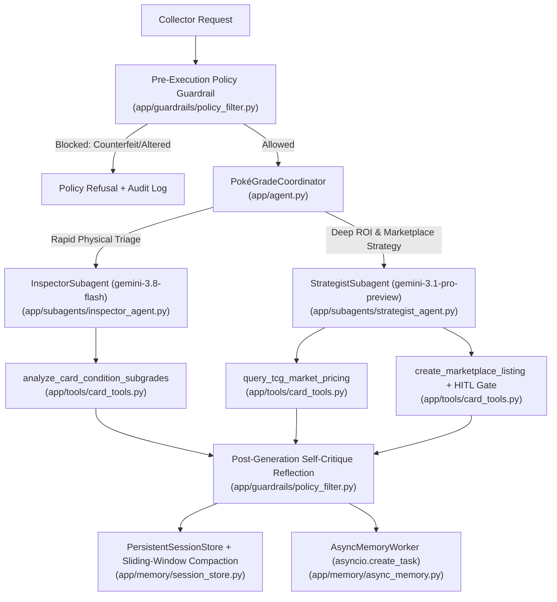

# PokéGrade AI — Enterprise Multi-Agent Collectible Card Grading & Marketplace Concierge

**PokéGrade AI** is a production-grade multi-agent application built on Google Cloud Platform (Vertex AI Agent Runtime / ADK) that solves the evaluation economics, grading turnaround opacity, and personal data exposure challenges of the **$13B collectible trading card market**.

---

## Problem & Solution Overview

- **Problem**: Collectible Pokémon card grading fees ($25–$150+ per card) and multi-month turnaround times create high financial risk for collectors. Evaluating the four physical subgrades (**Centering, Corners, Edges, Surface**) and comparing raw vs. graded market multipliers requires domain expertise—leading to negative-ROI submissions, mispriced listings, and accidental exposure of collector PII (shipping addresses, PayPal emails, payment details).
- **Solution**:
  1. **Card Inspector Subagent (`gemini-3.8-flash`)**: Performs rapid, low-latency physical subgrade triage across Centering, Corners, Edges, and Surface using conservative PSA/BGS/CGC cap rules.
  2. **Market Strategy Subagent (`gemini-3.1-pro-preview`)**: Queries TCG market pricing, calculates fee-adjusted breakeven grades and net ROI, and advises whether to submit for grading (`SUBMIT_FOR_GRADING`) or sell raw (`SELL_RAW_UNGRADED`).
  3. **Human-in-the-Loop (HITL) Marketplace Protection**: Blocks state-changing marketplace listings until an explicit human confirmation token (`HUMAN-OK-LIST-<id>`) is verified.
  4. **Enterprise AgentOps Observability**: Emits OpenTelemetry distributed traces, structured JSON logs, explicit `log_intent` / `log_outcome` audit records, and active regex PII scrubbing.

---

## Architecture Diagram



---

## 95-Point AgentOps Code Review Matrix Mapping

| Category | Criterion (5 pts each) | Raw Rubric Requirement | Code Evidence |
|---|---|---|---|
| **1. Tool & Interface Design (20 pts)** | **Comprehensive Tool Docstrings** | Clear, human-readable descriptions of purpose and all parameters | [`app/tools/card_tools.py`](app/tools/card_tools.py) (Google-style docstrings on all 3 domain tools) |
| | **Descriptive Naming** | Highly specific and clear tool names | `analyze_card_condition_subgrades`, `query_tcg_market_pricing`, `create_marketplace_listing` |
| | **Explicit JSON Schemas** | Strict input and output schemas to validate tool arguments and constrain LLMs | [`app/tools/schemas.py`](app/tools/schemas.py) (`BaseModel`, `Field(ge=1.0, le=10.0)`, `Rarity`, `GradingCompany`, `Condition` Enums) |
| | **Guided Error Handling** | Tool error returns provide descriptive recovery instructions back to the LLM | [`app/tools/card_tools.py`](app/tools/card_tools.py) (`GuidedToolError` with `guided_recovery` instructions) |
| **2. Context & Memory (20 pts)** | **Robust System Instructions** | Clear "constitution" in system prompt for persona, domain knowledge, and constraints | [`app/prompts/constitution.py`](app/prompts/constitution.py) (`SYSTEM_CONSTITUTION`, subagent prompts) |
| | **History Compaction** | Token-based truncation, sliding windows, summarization via ADK Compaction, Memory Bank, or Context Caching on Google Cloud | [`app/memory/session_store.py`](app/memory/session_store.py) (`compact_history`, `build_adk_events_compaction_config` (`EventsCompactionConfig`), `build_vertex_ai_memory_bank_service` (`VertexAiMemoryBankService`), `build_gcp_context_cache_config` (`ContextCacheConfig`)) |
| | **Persistent Session State** | Connects to a persistent database, vector store, or Vertex AI Search to retrieve conversational history across turns | [`app/memory/session_store.py`](app/memory/session_store.py) (Persistent SQLite vector database `vector_turn_store`, `retrieve_relevant_history` via Google Cloud Vertex AI Search `discoveryengine_v1.SearchServiceClient`, and `VertexAiRagMemoryService`) |
| | **Async Memory Operations** | Expensive memory generation and consolidation coded as background/async tasks | [`app/memory/async_memory.py`](app/memory/async_memory.py) (`AsyncMemoryWorker.schedule_card_indexing` via `asyncio.create_task`) |
| **3. Orchestration & Logic (20 pts)** | **Multi-Agent Patterns** | Proven design patterns (Coordinator, Sequential) rather than monolithic agents in ADK | [`app/agent.py`](app/agent.py) (`PokeGradeCoordinator`, ADK `SequentialAgent` `pokegrade_sequential_appraisal_pipeline`, ADK Coordinator `Agent` `pokegrade_coordinator`, and ADK `App`) |
| | **Strategic Model Routing** | Routes specific requests to the most appropriate model (Flash for fast tasks, Pro for planning) | [`app/agent.py`](app/agent.py) (`classify_and_route`: `gemini-3.8-flash` for Inspector vs. `gemini-3.1-pro-preview` for Strategist) |
| | **Guardrails & Policy Plugins** | Security and evaluation guardrails (self-eval) implemented via Google Cloud or ADK | [`app/guardrails/policy_filter.py`](app/guardrails/policy_filter.py) (`PolicyGuardrailPlugin(BasePlugin)` with `before_model_callback`/`after_model_callback`, self-critique reflection, and Vertex AI `SafetySetting`) |
| | **Human-in-the-Loop Hooks** | High-stakes actions include explicit code stops requiring human confirmation | [`app/tools/card_tools.py`](app/tools/card_tools.py) (`create_marketplace_listing` requires `HUMAN-OK-LIST-<id>` token) |
| **4. Observability & Tracing (20 pts)** | **Structured JSON Logging** | Utilizes structured logging libraries to capture rich metadata | [`app/observability/logger.py`](app/observability/logger.py) (`StructuredJSONFormatter`) |
| | **Intent vs. Outcome Capture** | Explicitly records both intended action before execution and actual outcome after | [`app/observability/logger.py`](app/observability/logger.py) (`log_intent`, `log_outcome`) |
| | **Distributed Tracing** | OpenTelemetry implementation linking spans from query to answer | [`app/observability/tracer.py`](app/observability/tracer.py) (OpenTelemetry `TracerProvider`, `start_trace_span`, Cloud Trace exporter) |
| | **PII Redaction** | Active scrubbing mechanisms to redact sensitive data before storage using Google Cloud APIs | [`app/observability/redact.py`](app/observability/redact.py) (`CloudDLPRedactor` using `google.cloud.dlp_v2.DlpServiceClient.deidentify_content` + regex scrubbing) |
| **5. Infrastructure & CI/CD (15 pts)** | **Automated Evaluation Suites** | Testing harness against a golden dataset to statically measure agent regressions | [`tests/eval/golden_dataset.json`](tests/eval/golden_dataset.json), [`tests/eval/eval_harness.py`](tests/eval/eval_harness.py) |
| | **Infrastructure as Code** | Terraform configurations to provision resources + `agents-cli` usage in documentation | [`terraform/main.tf`](terraform/main.tf), [`terraform/variables.tf`](terraform/variables.tf), [`terraform/outputs.tf`](terraform/outputs.tf), and `agents-cli` documentation below |
| | **Secure Secret Management** | No hardcoded API keys; all tools and clients leverage Secret Manager | [`app/tools/secret_manager.py`](app/tools/secret_manager.py) (`SecretManagerService` wrapping `google-cloud-secret-manager`) |

---

## Google Cloud `agents-cli` & ADK Lifecycle Commands

This repository is structured for the Google Cloud **`agents-cli`** (Agent Starter Pack / ADK CLI) workflow across local prototyping, automated evaluation, Terraform provisioning, and Vertex AI Agent Engine deployment:

```bash
# 1. Inspect project configuration and available templates
agents-cli info

# 2. Scaffold or enhance an ADK multi-agent project with CI/CD & Terraform
agents-cli scaffold create pokegrade-ai \
  --agent-garden \
  --deployment-target agent-engine \
  --region us-central1

# 3. Run the PokéGrade AI ADK Coordinator interactively in the terminal or web playground
agents-cli run app
agents-cli playground

# 4. Run Automated Evaluation Suites against the Golden Dataset
agents-cli eval run --dataset tests/eval/golden_dataset.json
uv run python -m tests.eval.eval_harness

# 5. Provision Google Cloud Infrastructure via Terraform (Vertex AI, Secret Manager, Cloud DLP, Vertex AI Search, Vector Search)
terraform -chdir=terraform init
terraform -chdir=terraform plan -var="project_id=${GOOGLE_CLOUD_PROJECT}"
terraform -chdir=terraform apply -var="project_id=${GOOGLE_CLOUD_PROJECT}"

# 6. Deploy the Agent to Vertex AI Agent Runtime / Reasoning Engine via agents-cli
agents-cli deploy \
  --project "${GOOGLE_CLOUD_PROJECT}" \
  --region us-central1 \
  --target agent-engine \
  --agent-module app.agent:adk_app
```

---

## Quickstart & Local Verification

```bash
# 1. Compile-check all Python modules
python3 -m compileall -q app tests

# 2. Run the Golden Dataset Evaluation Harness (7/7 scenarios)
uv run python -m tests.eval.eval_harness

# 3. Run the Full Pytest Unit Test Suite
uv run pytest -v
```

